# PlanSpace

**PlanSpace** is a local-first, all-in-one desktop workspace for **Agile Planning**, **Visual Brainstorming (Mind Maps & Flowcharts)**, **Rich Technical Documentation**, and **Daily Journaling** — built with Electron, React, TypeScript, TipTap, React Flow, and IndexedDB (Dexie).

Every component in PlanSpace is deeply interconnected: brainstorm ideas on an infinite **Mind Map** or **Flowchart**, convert any node into an actionable **Sprint Task** in one click, or embed live interactive diagrams directly inside your **Docs** and **Daily Notes**.

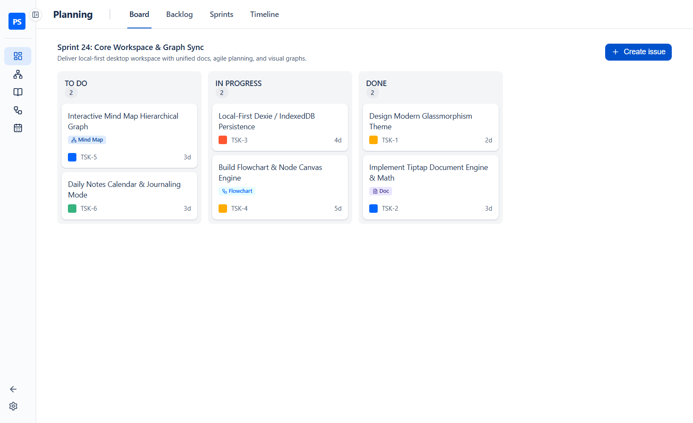

---

## Documentation Index (Sub-READMEs)

Explore the dedicated module guides for step-by-step workflows, screenshots, and keyboard shortcuts:

| Module Guide | What You Will Learn |
| :--- | :--- |
| **[1. Agile Planning Guide](docs/planning.md)** | Kanban Board, Backlog & Sprints, Sprint Analytics, Interactive Gantt Timeline, and Task Details Modal |
| **[2. Mind Maps & Flowcharts Guide](docs/diagrams.md)** | Rapid keyboard-first brainstorming, smart 4-side edge routing, auto-layout, node-to-task conversion, and PNG export |
| **[3. Docs & Daily Notes Guide](docs/docs-and-notes.md)** | Hierarchical pages, `/` slash command menu, live interactive diagram embeds, LaTeX math, tables, and Rolling Daily Notes |
| **[4. Cross-Linking, Shortcuts & Data Guide](docs/linking-and-shortcuts.md)** | Global `Ctrl+K` Command Palette, bi-directional linking across all modules, keyboard shortcuts, and JSON backup/restore |

---

## Key Highlights

### 1. Agile Sprint Planning (Board, Backlog, Sprints & Gantt Timeline)
- **Kanban Board**: Smooth drag-and-drop issue cards across `To Do`, `In Progress`, and `Done` with inline `+ Create issue` quick entry and visual badges for linked Mind Maps, Flowcharts, and Docs.
- **Backlog & Sprint Management**: Drag issues between the Backlog and Planned/Active Sprints, cycle task status in 1 click (`TO DO` → `IN PROGRESS` → `DONE`), and track sprint completion metrics.
- **Interactive 60fps Gantt Timeline**: Drag any task bar horizontally to reschedule its start date or drag its right handle to resize its duration in days.

| Kanban Board | Interactive Gantt Timeline |
| :---: | :---: |
|  | 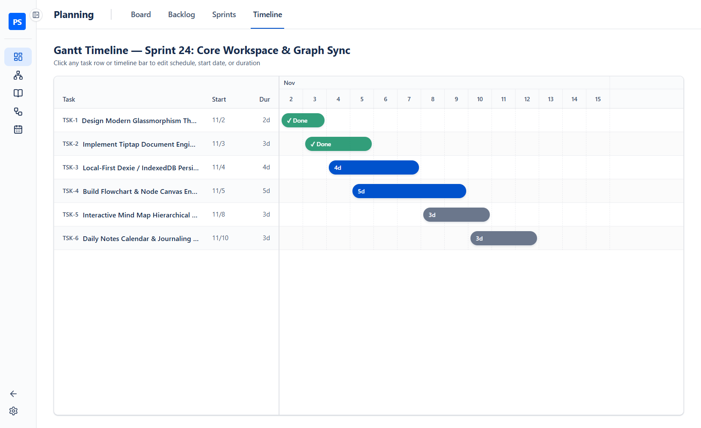 |

| Backlog & Sprints | Task Details & Linked Diagrams |
| :---: | :---: |
| 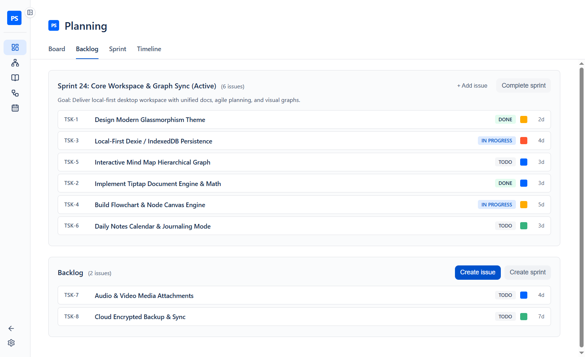 | 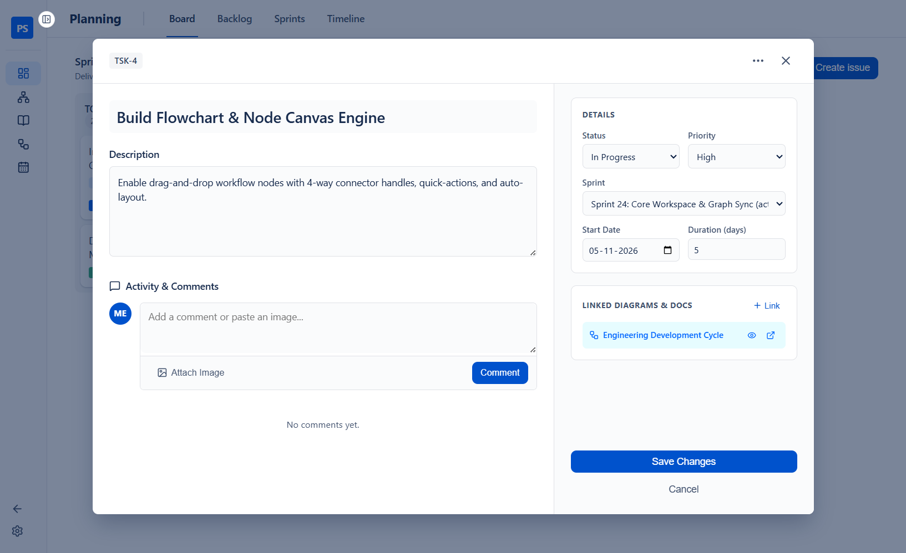 |

👉 **[Read the full Agile Planning Guide →](docs/planning.md)**

---

### 2. Fluid Visual Brainstorming (Mind Maps & Flowcharts)
- **Keyboard-First Mind Mapping**: Press `Tab` to spawn a child idea, `Enter` to spawn a sibling idea, or **double-click anywhere on the canvas** to create a node at your cursor and start typing immediately.
- **Smart Flowchart Builder**: Click or drag shapes (`Process`, `Decision`, `Start / End`, `Database`), press `Tab` or click `+ Step` to chain connected steps, and enjoy 60fps smart 4-side handle routing (`top`, `right`, `bottom`, `left`) as you drag nodes.
- **1-Click Node-to-Task & Diagram Embedding**: Hover any node and click the `☑️` icon to turn it into a Sprint Task, or click **`Add to Doc / Task`** in the header to embed the diagram into any Document or Task.

| Mind Map Canvas | Flowchart Canvas |
| :---: | :---: |
| 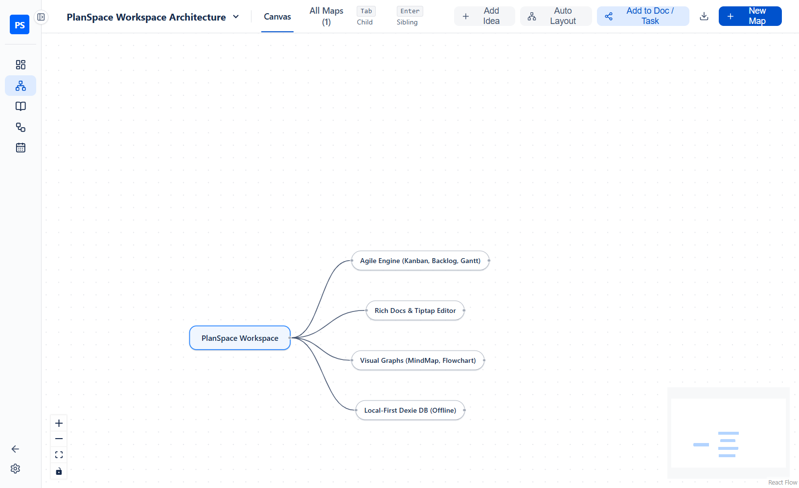 | 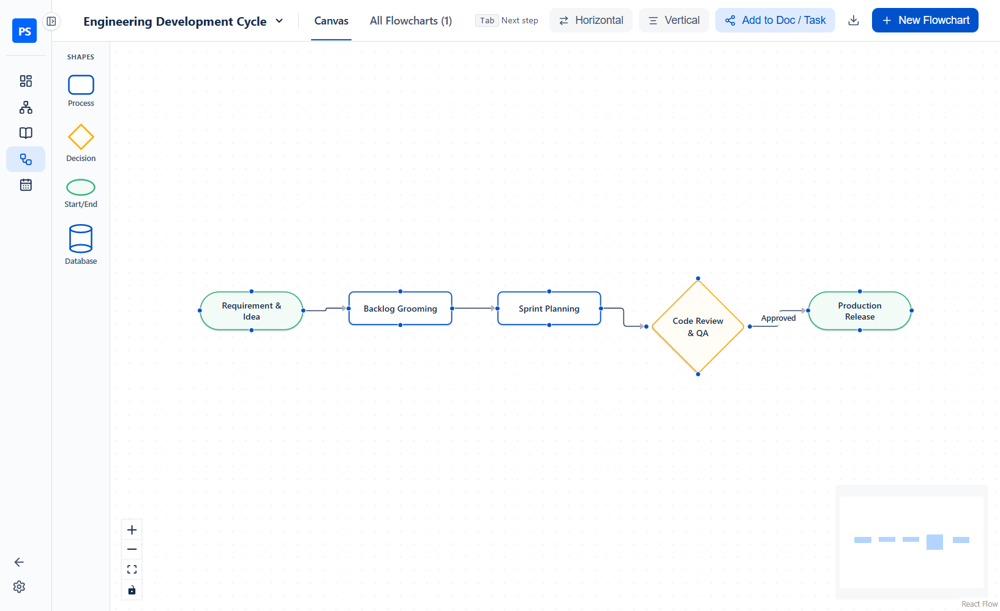 |

👉 **[Read the full Mind Maps & Flowcharts Guide →](docs/diagrams.md)**

---

### 3. Rich Docs & Daily Notes with Live Diagram Embeds
- **Hierarchical Knowledge Base**: Nest subpages infinitely, auto-generate a Table of Contents, write LaTeX math, insert resizable tables and task checklists, and export to **PDF** or **Word (`.doc`)**.
- **Interactive `/` Slash Menu & Toolbar**: Type `/` anywhere in the editor (or use the **`Embed Diagram`** and **`Link`** toolbar buttons) to embed live Mind Maps and Flowcharts or insert smart reference pills (`☑️ Task`, `🧠 Mind Map`, `🔀 Flowchart`, `📄 Doc`, `📅 Date`).
- **Daily Notes (Single Day & Rolling View)**: Capture daily standups and engineering logs with a mini calendar indicator and a continuous 14-day Rolling View.

| Docs with Embedded Diagrams | Expanded Interactive Diagram Preview |
| :---: | :---: |
| 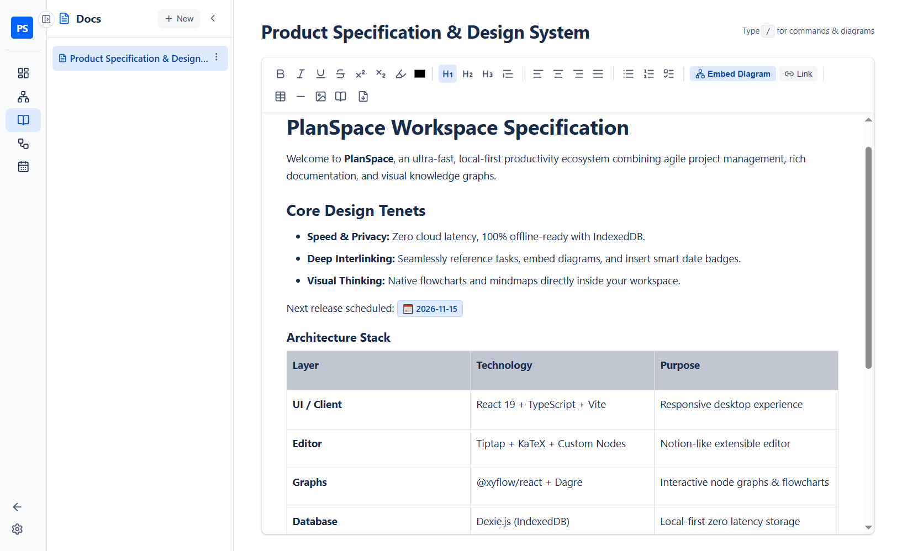 | 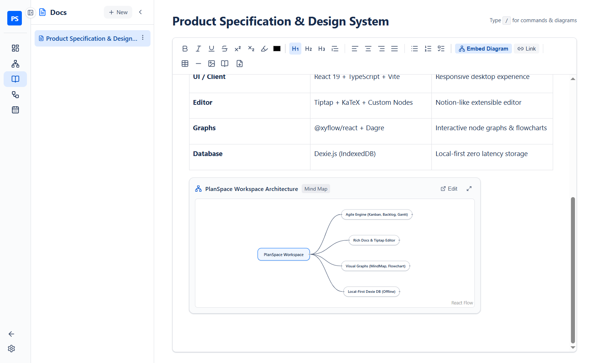 |

| Daily Notes (Single Day) | Daily Notes (Rolling View) |
| :---: | :---: |
| 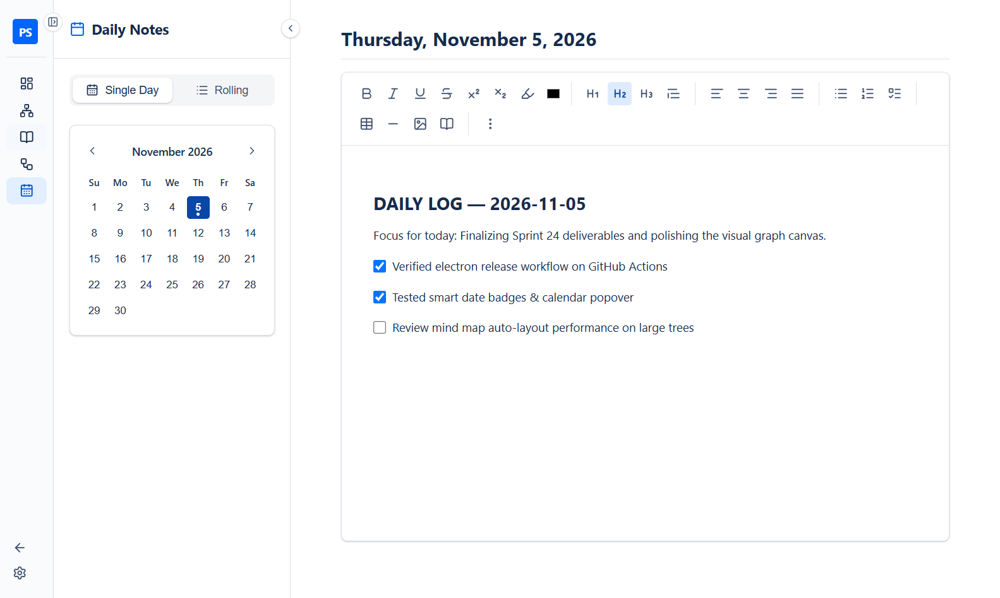 | 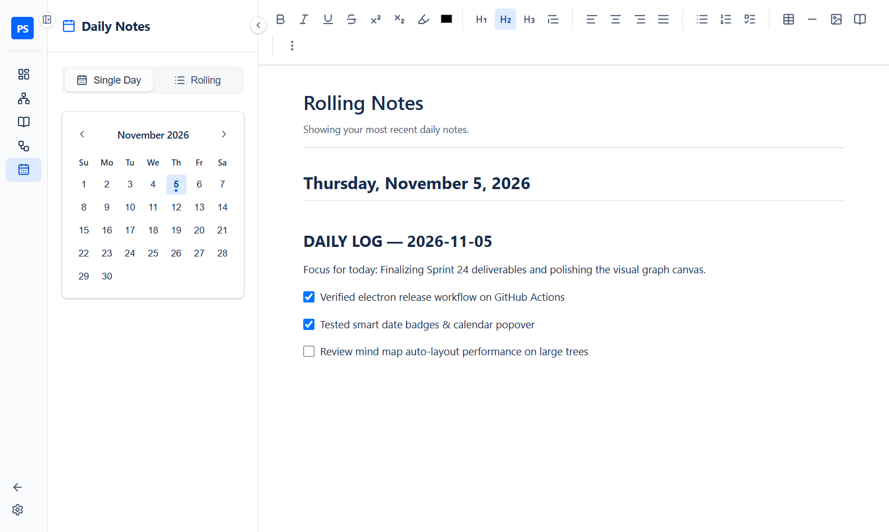 |

👉 **[Read the full Docs & Daily Notes Guide →](docs/docs-and-notes.md)**

---

### 4. Global `Ctrl+K` Command Palette & Cross-Component Linking
- Press **`Ctrl+K`** (or click **Search or jump to...** in the top window bar) from anywhere to search across all Tasks, Docs, Mind Maps, Flowcharts, and Daily Notes, or type any title to create a new task on the spot.
- Every link is **bi-directional and interactive**: clicking a badge on a Task, a node in a Mind Map/Flowchart, or a smart pill in a Doc jumps straight to the target item.

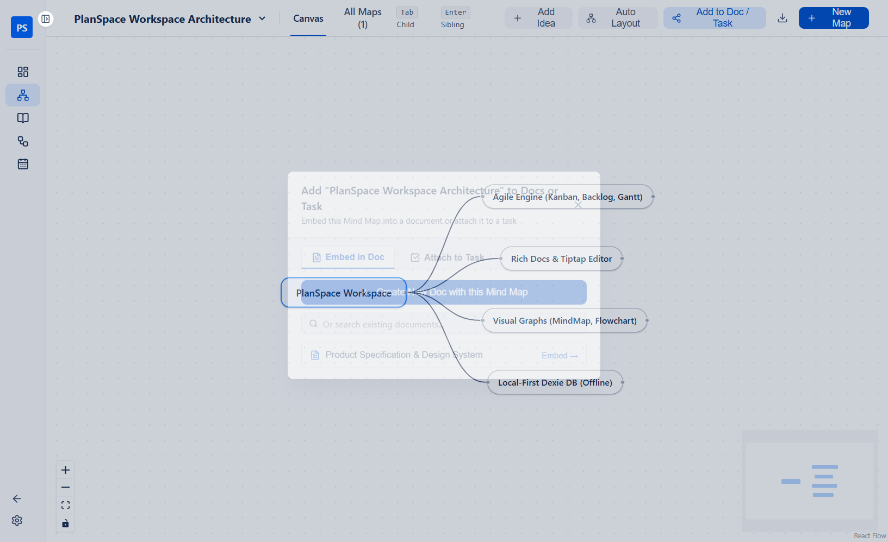

👉 **[Read the full Cross-Linking & Shortcuts Guide →](docs/linking-and-shortcuts.md)**

---

## Getting Started

### Prerequisites
- **Node.js** `v18+` and **npm**

### Installation & Development
```bash
# 1. Install dependencies
npm install

# 2. Launch PlanSpace in desktop development mode (Vite + Electron)
npm run dev
```

### Building for Production
```bash
# Type-check, build renderer & Electron bundles, and package desktop installer
npm run build
```

### Running Unit Tests
```bash
npx vitest run
```

---

## Tech Stack & Architecture

| Layer | Technology |
| :--- | :--- |
| **Desktop Runtime** | Electron (`electron`, `electron-builder`, `electron-updater`) |
| **Frontend Framework** | React 19 + TypeScript + Vite |
| **Local Database** | IndexedDB powered by **Dexie.js** (`dexie`, `dexie-react-hooks`, `dexie-export-import`) |
| **Diagramming Engine** | **React Flow** (`@xyflow/react`) + **Dagre** (`@dagrejs/dagre`) auto-layout |
| **Rich Text Editor** | **TipTap** (`@tiptap/react`, StarterKit, Tables, TaskLists, KaTeX Math, Search & Replace) |
| **Drag & Drop** | **dnd-kit** (`@dnd-kit/core`, `@dnd-kit/sortable`) |
