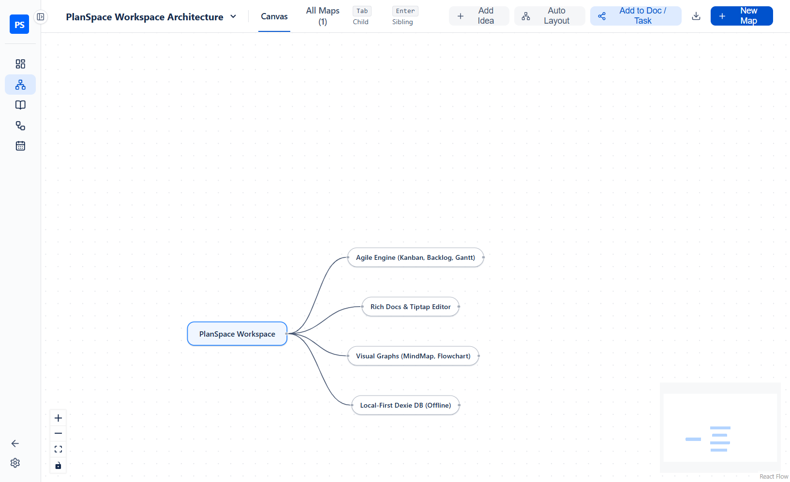
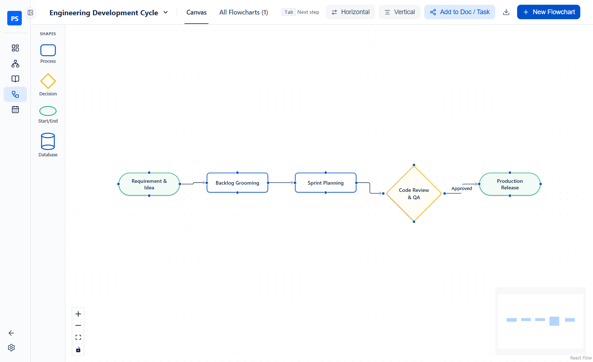
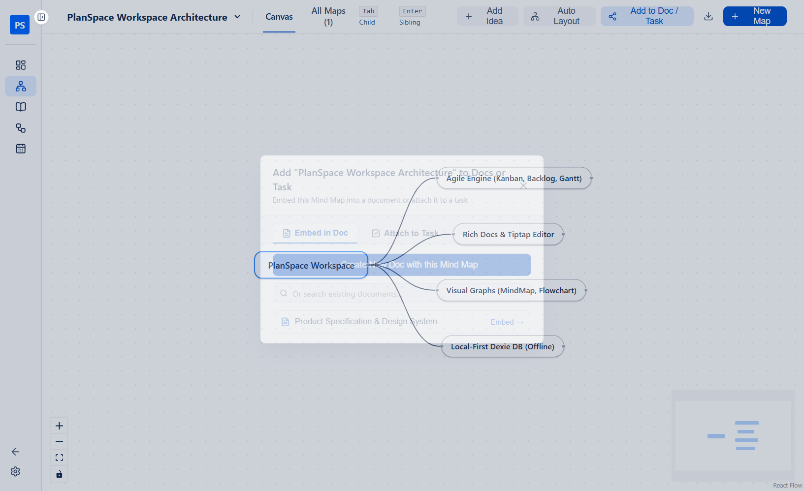

# Mind Maps & Flowcharts Guide (Visual Brainstorming)

← [Back to Main README](../README.md)

PlanSpace includes two dedicated infinite-canvas diagramming tools — **Mind Map** and **Flowchart** — designed for high-speed brainstorming and direct integration with your Tasks and Docs.

---

## 1. Mind Maps (`/mindmap`)

The **Mind Map** view is optimized for rapid hierarchical ideation without taking your hands off the keyboard.

### Rapid Brainstorming Workflows
- **Keyboard-First Creation**:
  - **`Tab` / `Insert`**: Add a **Child Idea** to the currently selected node and immediately focus its text input.
  - **`Enter`**: Add a **Sibling Idea** at the same level (or commit text while editing).
  - **`Double-Click Empty Canvas`**: Spawn a new connected idea right at your cursor position.
  - **`Double-Click Node` / `F2`**: Edit the selected node's text inline.
  - **`Delete` / `Backspace`**: Delete the selected node and all of its descendant sub-branches cleanly (leaving zero orphan nodes).
- **On-Node Quick Actions**:
  - Hover or select any node to reveal the **`+`** button on its right edge (adds a child idea), the **`✏️` Rename** button, and the **`☑️` Convert to Task** button.
- **1-Click Auto Layout**: Click **`Auto Layout`** in the header to organize your entire mind map tree with Dagre hierarchical spacing.
- **Diagram Switcher & Management**: Switch between mind maps instantly using the header dropdown, or click **`All Maps`** to rename or delete maps.

---

## 2. Flowcharts (`/flowchart`)

The **Flowchart** view lets you map out system architectures, user flows, and decision trees with smart 4-directional connectors.

### Rapid Flowchart Workflows
- **Adding Steps**:
  - **Click or Drag from Shape Palette**: Click `Process`, `Decision`, `Start / End`, or `Database` in the left palette to spawn a step automatically connected to your currently selected node, or drag a shape onto any canvas position.
  - **Double-Click Empty Canvas**: Spawn a new step at your cursor (automatically connected if a node is selected).
  - **Press `Tab` While Editing**: Saves the current step's label and immediately creates and focuses the next connected step in the flow direction.
  - **Floating `+ Step` Toolbar**: Hover or select any shape and click **`+ Step`** in the floating mini-toolbar above it.
- **60fps Smart 4-Side Routing**:
  - Every shape supports connections on all 4 sides (`Top`, `Right`, `Bottom`, `Left`).
  - As you drag a node around another node, PlanSpace dynamically recalculates the shortest attachment sides in real time so connector lines never loop awkwardly.
- **Connector Context Menu (Right-Click / Double-Click)**:
  - **Double-click any connector line** (or right-click → **`✏️ Edit Label`**) to add decision labels such as `Yes`, `No`, or `Approved`.
  - Right-click any connector to **Reverse Direction (`↩`)**, **Toggle Double Arrow (`↔`)**, or **Delete (`🗑`)**.
- **Horizontal & Vertical Auto-Layout**:
  - Click **`Horizontal`** (`Left → Right`) or **`Vertical`** (`Top → Bottom`) in the header to automatically align connected components and update all edge handles.

---

## 3. Sending Diagrams to Docs or Tasks

Both **Mind Map** and **Flowchart** feature an **`Add to Doc / Task`** button in the top toolbar and a **`☑️` Convert to Task** button on every individual node.

- **Embed in Doc**:
  - Click **`Create New Doc with this Mind Map / Flowchart`** to generate a new document pre-populated with a live, interactive diagram card.
  - Or pick any existing document from the searchable list to append the interactive diagram card to it.
- **Attach to Task**:
  - Click **`Create New Task Linked to this Mind Map / Flowchart`** to create a new issue in your active sprint with the diagram attached.
  - Or select any existing task to link the diagram to it.
- **Export as PNG**: Click the **Download (`⬇`)** button in the header to export a high-resolution PNG image of your canvas.
