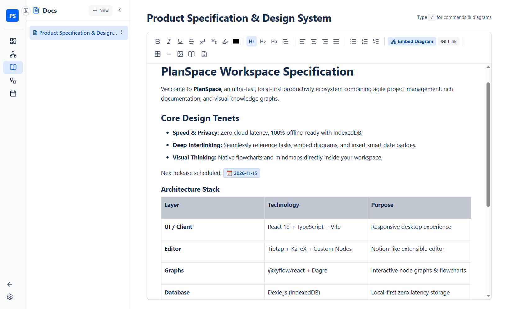
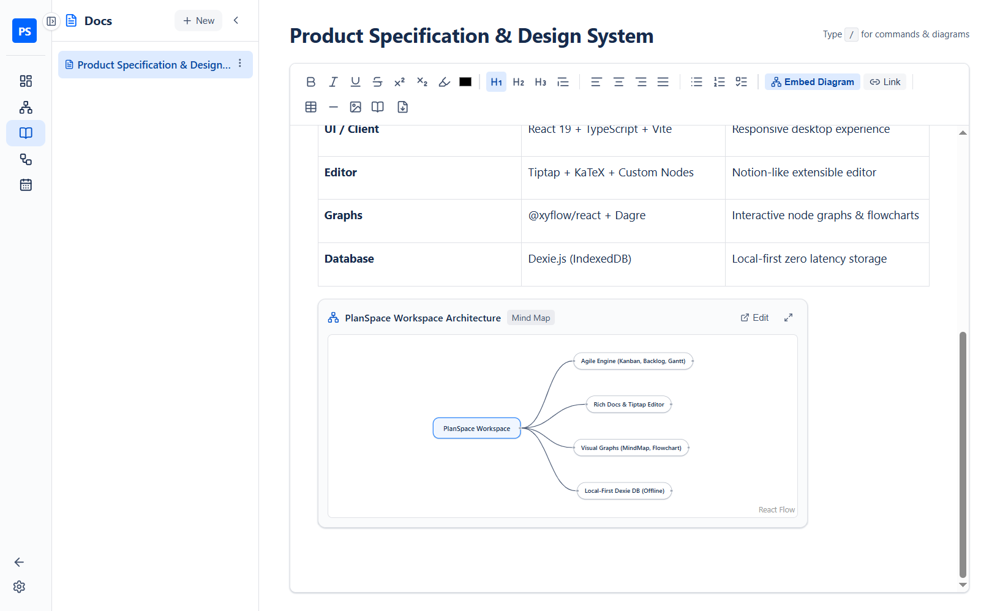
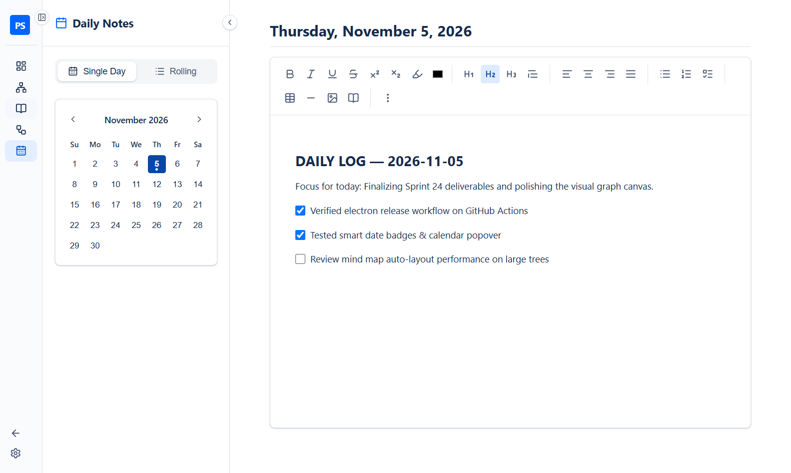
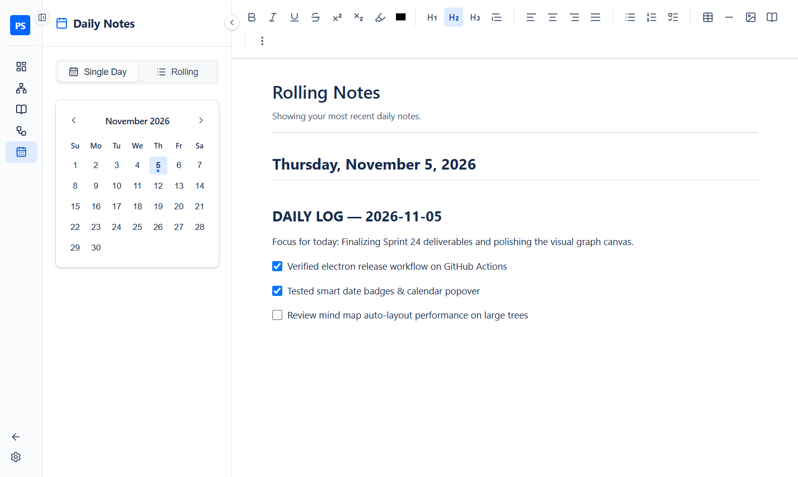

# Docs & Daily Notes Guide

← [Back to Main README](../README.md)

PlanSpace combines a hierarchical **Knowledge Base (`Docs`)** and a date-indexed **Engineering Journal (`Daily Notes`)** powered by a customized TipTap rich-text editor with live diagram embeds, smart references, LaTeX math, and document export.

---

## 1. Hierarchical Docs (`/docs`)

The **Docs** module lets you organize specifications, architecture notes, and meeting docs into an infinitely nestable page tree.

### Managing Pages
- **Create Root Pages & Subpages**: Click **`+ New`** in the Docs sidebar to create a top-level document, or hover any page and click **`⋮` → `Add Subpage`** to nest child pages underneath it.
- **Quick Rename (`F2`)**: Press `F2` (or **`⋮` → `Rename`**) to rename any document inline.
- **Collapsible Sidebar**: Collapse the Docs tree sidebar at any time for a distraction-free writing canvas.

---

## 2. Live Diagram Embeds & Smart References

Documents in PlanSpace are not static text — they can host live, interactive previews of your **Mind Maps** and **Flowcharts** alongside clickable smart pills for **Tasks**, **Docs**, and **Daily Notes**.

### 3 Ways to Embed or Link
1. **Toolbar Quick Buttons**:
   - Click **`Embed Diagram`** in the editor toolbar to insert a live **Mind Map** or **Flowchart** card at your cursor.
   - Click **`Link`** in the editor toolbar to insert an inline smart reference pill to a **Task (`☑️`)**, **Mind Map (`🧠`)**, **Flowchart (`🔀`)**, **Document (`📄`)**, or **Date Badge (`📅`)**.
2. **Interactive `/` Slash Command Menu**:
   - Type **`/`** anywhere in the editor to open the keyboard-navigable Slash Command popup (`↑`/`↓` + `Enter`):
     - `Embed Mind Map` / `Embed Flowchart`
     - `Link Task` / `Link Mind Map` / `Link Flowchart` / `Link Document` / `Link Daily Note`
     - `Date Badge` / `Task Checklist` / `Heading 1` / `Heading 2` / `Table (3×3)`
3. **Fast Text Shortcuts**:
   - Type `//mindmap` or `//flowchart` + `Space` to embed a diagram card.
   - Type `/task`, `/mindmap`, `/flowchart`, `/docs`, `/dailynotes`, or `/date` + `Space` to insert an inline smart pill.

### Interacting with Embedded Diagram Cards
- **Live Sync**: Embedded cards query IndexedDB live — any edits made in the Mind Map or Flowchart canvas automatically appear in your Doc.
- **Expand Preview (`Maximize`)**: Click anywhere on an embedded diagram card (or click the expand icon) to inspect it in an interactive pan-and-zoom modal without leaving your document.
- **Jump to Editor (`Edit ↗`)**: Click **`Edit`** on the card header to open that diagram directly in the full Mind Map or Flowchart editor.

---

## 3. Rich Formatting, Tables, Math & Export

- **Rich Typography & Lists**: Bold, Italic, Underline, Strikethrough, Superscript, Subscript, Multicolor Highlight, Custom Text Color, Headings (`Ctrl+1/2/3`), Blockquotes, Bullet Lists, Ordered Lists (with smart `Tab` nesting), and interactive **Task Checklists**.
- **Tables & Media**: Insert resizable tables, horizontal dividers, images, and a dynamic **Table of Contents** block that links to every heading in your doc.
- **In-Document Search (`Ctrl+F`)**: Press `Ctrl+F` inside the editor to highlight search matches across the document.
- **Export (`PDF` & `Word`)**: Click the **Export (`⬇`)** button on the right of the toolbar to export your document as a `.pdf` or `.doc` file.

---

## 4. Daily Notes (`/daily-notes`)

The **Daily Notes** module provides a date-based scratchpad and engineering log.

| Single Day View | Rolling 14-Day View |
| :---: | :---: |
|  |  |

### Key Features
- **Interactive Mini Calendar**: Dates with existing notes display a blue indicator dot. Click any date to jump to that day's entry.
- **Single Day vs. Rolling Mode**:
  - **Single Day**: Focuses on the selected date with a dedicated formatting toolbar.
  - **Rolling Mode**: Displays today's note followed by your most recent daily notes in a continuous scrollable feed with a sticky top toolbar.
