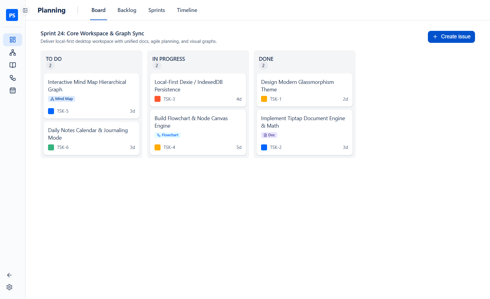
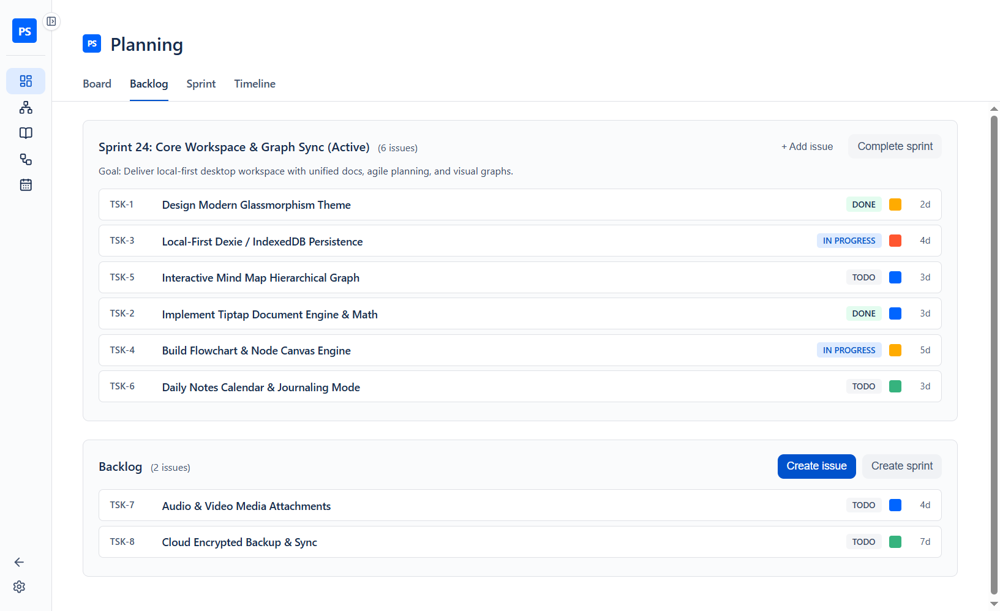
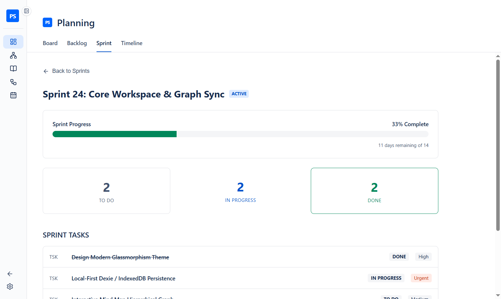
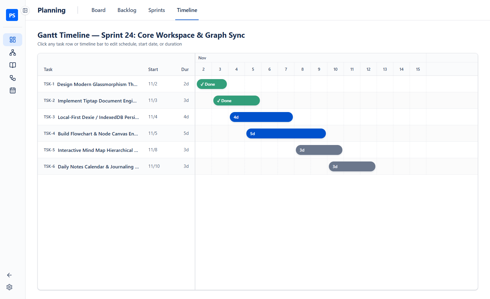
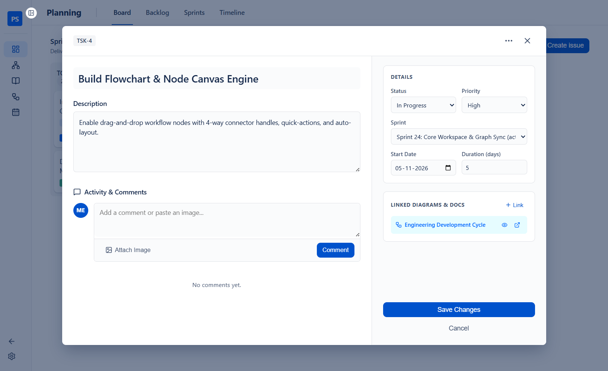

# Agile Planning Guide (Board, Backlog, Sprints & Gantt Timeline)

← [Back to Main README](../README.md)

PlanSpace provides a complete local-first Agile project management suite under the **Planning** navigation tab, combining a **Kanban Board**, **Backlog & Sprint Planner**, **Sprint Analytics**, and an **Interactive 60fps Gantt Timeline**.

---

## 1. Kanban Board (`/planning/board`)

The **Kanban Board** displays all issues in your currently **Active Sprint** across three workflow columns: `To Do`, `In Progress`, and `Done`.

### Key Features
- **Smooth Drag-and-Drop**: Drag issue cards between columns or reorder them vertically within a column. Moving a card to `In Progress` automatically records its `startDate` if not already set.
- **Inline Quick-Add (`+ Create issue`)**: Click **`+`** in any column header or **`+ Create issue`** at the bottom of a column, type a title, and press `Enter` to add tasks rapidly without opening a modal.
- **Visual Reference Badges**: Cards automatically display color-coded badges (`Mind Map`, `Flowchart`, `Doc`) whenever an issue is linked to a diagram or document.

---

## 2. Backlog & Sprint Management (`/planning/backlog`)

The **Backlog** view lets you organize upcoming work, group issues into **Planned Sprints**, and manage your **Active Sprint**.

### Key Features
- **Cross-Container Dragging**: Drag tasks seamlessly between the **Backlog** and any **Sprint**.
- **1-Click Status Cycling**: Click the status pill (`TO DO` → `IN PROGRESS` → `DONE`) on any row to advance a task's status immediately.
- **Inline Quick-Add Input**: Use the `+ Quick add issue to ... (Enter)` input bar at the bottom of any Sprint or the Backlog to add tasks with zero modal friction.
- **Starting & Completing Sprints**:
  - Click **`Create sprint`** to define a new sprint with a name, goal, and duration (`7`, `14`, `21`, or `28` days).
  - Click **`Start sprint`** on any planned sprint to make it active on the Kanban Board and Gantt Timeline.
  - Click **`Complete sprint`** to finish the active sprint; any unfinished tasks (`To Do` or `In Progress`) are automatically returned to the Backlog.

---

## 3. Sprint Details & Analytics (`/planning/details`)

The **Sprints** tab provides an overview of all Active, Planned, and Completed sprints along with completion percentages and status breakdowns (`To Do`, `In Progress`, `Done`).

---

## 4. Interactive Gantt Timeline (`/planning/gantt`)

The **Timeline** tab renders your active sprint's tasks on a synchronized day-by-day **Gantt Chart**.

### Key Features
- **Drag Bar to Reschedule**: Click and drag any task bar horizontally across the timeline to shift its `Start Date`.
- **Drag Right Edge to Resize Duration**: Grab the right edge handle of any task bar and drag left or right to change its duration in days (`1d` up to the sprint length).
- **Today Highlight Column**: The current calendar day is highlighted vertically so you can immediately spot schedule drift.
- **Inline Timeline Quick-Add**: Type in the `+ Quick add task to timeline (Enter)...` row at the bottom of the left pane to schedule a new task on the spot.

---

## 5. Task Details Modal & Bi-Directional References

Clicking any task card or row opens the **Task Modal**.

### Key Features
- **Metadata Controls**: Edit Status, Priority (`Low`, `Medium`, `High`), Sprint assignment, Start Date, and Duration (in days).
- **Linked Diagrams & Docs**:
  - Click **`+ Link`** to attach any **Mind Map**, **Flowchart**, or **Document** to the task.
  - Click the **Eye (`👁`)** icon on a linked Mind Map or Flowchart badge to open an interactive pan/zoom preview right inside the Task Modal.
  - Click the **External Link (`↗`)** icon to jump straight to that Mind Map, Flowchart, or Document in the full editor.
- **Activity & Image Comments**: Post updates, attach images, or paste screenshots (`Ctrl+V`) directly into the comment thread. Double-click any attached image to inspect it full-screen.
